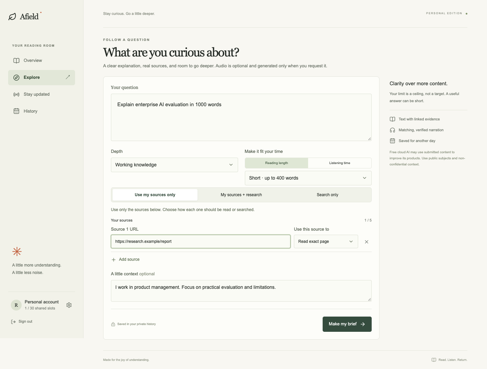
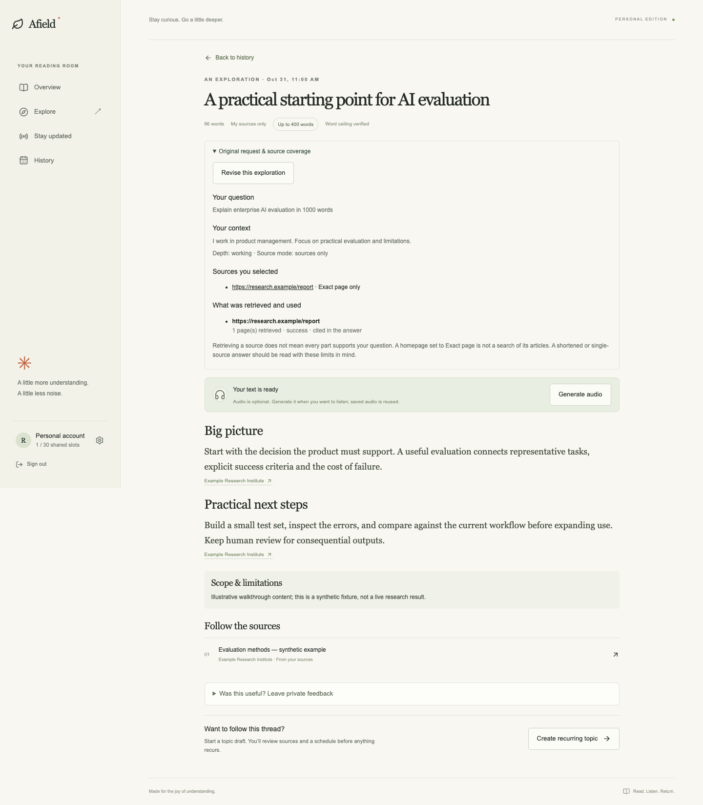

# Afield

**Explore something new. Keep up with what matters.**

Afield helps curious knowledge workers, product professionals, and people entering unfamiliar fields turn scattered public information into useful, source-linked reading. Explore answers a one-off question; Stay Updated follows a topic over time. Both save the text brief and offer narration only when the reader requests it.

**Status:** invite-only personal proof of concept. The repository contains the current implementation and v0.5 requirements. Automated tests use synthetic data; full live OAuth, narration, scheduling, and hosted operation still have acceptance gates. See [test results](docs/testing/RESULTS.md) and [known gaps](docs/product/CHANGELOG.md).

## Features

- **Explore:** ask a question with context, choose depth and a word/listening budget, resolve any conflicting length request, then receive a cited brief.
- **Stay Updated:** configure a topic, optional subtopics, reviewed sources, reusable block templates, and a daily/weekly schedule; run a manual update with independent coverage settings.
- **Source controls:** use selected sources, combine them with wider research, or search only. Each URL can read one page, parse a feed, follow bounded links, or search within its site. Site search uses Tavily even in sources-only mode.
- **Learning-source suggestions:** inspect publisher evidence and screen sales/demo funnels; recommend recurring publication sites and return fewer results when evidence is weak. Recommendations need human approval.
- **Saved reading:** overview, date/topic history, original request and source-coverage inspection, revision as a new request, and linked citations.
- **Optional audio:** explicit Generate audio, deduplicated jobs, private exact-script/profile cache, measured duration and independent transcript checks.
- **Account controls:** email/password and Google OAuth routes, invitation admission, usage/reset visibility, export and queued deletion.

## Product walkthrough

Screens show the actual app with synthetic API fixtures, captured from the current build. They demonstrate interface behavior, not successful live provider execution. [All main-flow screens and instructions](docs/walkthrough/README.md).

| Step | What the reader does | Screen |
|---|---|---|
| 1 | Sign in with an invited account | [Sign in](docs/walkthrough/images/01-sign-in.png) |
| 2 | Ask a question, choose sources and output settings | [Explore](docs/walkthrough/images/03-explore.png) |
| 3 | Resolve conflicting limits and follow progress | [Review](docs/walkthrough/images/04-explore-review.png) · [Progress](docs/walkthrough/images/05-progress.png) |
| 4 | Read the saved answer, inspect citations and optionally request audio | [Brief](docs/walkthrough/images/06-brief.png) |
| 5 | Set up a recurring topic, sources, templates and schedule | [Topic](docs/walkthrough/images/08-topic-settings.png) · [Sources](docs/walkthrough/images/09-topic-sources.png) · [Template](docs/walkthrough/images/10-topic-templates.png) |
| 6 | Revisit briefs through history | [History](docs/walkthrough/images/13-history.png) |





## Run locally

Verified development runtime: **Node.js 26**, npm, and a browser supported by Playwright.

```sh
npm ci
cp apps/web/.env.example apps/web/.env.local
# Fill in your own configuration; never commit apps/web/.env.local.
npm run check
npm run lint
npm test
npm run test:db
npm run build
npm run start
```

Open http://localhost:3000. Read [setup](docs/KEYS-AND-SETUP.md) before enabling live generation. In a separate terminal, run `npm run worker:local` when you want queued work processed. The web server saves jobs; the worker performs research/audio/schedules. Without an awake worker, new work waits. A new clone contains no account, secrets, private history, or preconfigured cloud resources.

For isolated UI tests, install Chromium with `npx playwright install chromium`, then run `npm run test:e2e`. The test runner starts a production server on port 3100 with dummy configuration and live generation disabled; it never needs your private environment. [Testing guide](docs/testing/TEST-PLAN.md).

## Tech stack

| Layer | Implementation |
|---|---|
| Web | Next.js 16.4.3, React 19.3.1, TypeScript 5.9.3, CSS, Lucide |
| Validation and data | Zod 4.6.7, Supabase Auth/Postgres/private Storage; SQL migrations and ownership/RLS |
| Research | Gemini structured responses, optional Tavily, Cheerio, fast-xml-parser, Undici with guarded retrieval |
| Audio | Gemini speech/transcription, FFmpeg/FFprobe verification and encoding |
| Jobs | Local Node worker or supplied Trigger.dev 4.8.1 tasks |
| Time | Temporal polyfill and named timezone schedules |
| Quality | Vitest, PGlite PostgreSQL, Playwright, ESLint, TypeScript; pinned dependencies and npm lockfile |
| Hosting | Next.js-compatible hosting; optional Vercel web and Trigger.dev worker. GitHub stores source and runs CI; it does not host this backend on Pages. |

Exact versions live in [app package.json](apps/web/package.json) and [package-lock.json](package-lock.json). Model names and free-plan access must be revalidated in the operator's provider accounts before live use; the code never silently switches to a paid fallback.

## Repository map

Run commands from the repository root. The npm workspace forwards them to `apps/web/`; application configuration and private local settings belong inside that folder. Inside the app, [feature folders](apps/web/src/features/README.md) own their models, behavior, UI and unit tests. [Feature branches and pull requests](docs/technical/DEVELOPMENT-WORKFLOW.md) isolate changes before integration.

```text
README.md              product overview and start here
apps/web/              complete runnable application
  src/                 framework adapters, feature modules, shared UI and infrastructure
  tests/               unit, database and browser cases
  supabase/migrations/ ordered database schema and functions
  scripts/             app readiness, connection check and local worker
  *.config.*           application build, test and worker configuration
  .env.example         safe configuration template
  package.json         application dependencies and scripts
docs/                  product, technical, user and verification material
.github/               CI, contribution/security policies and issue/PR templates
tooling/               repository-wide validation
package.json           shared commands and npm workspace definition
package-lock.json      one dependency lockfile for reproducible installation
```

[Documentation index](docs/README.md) links every supported documentation area and source folder. [System design](docs/technical/ARCHITECTURE.md) · [Product architecture](docs/technical/PRODUCT-ARCHITECTURE.md) · [Authentication model](docs/technical/AUTHENTICATION.md) · [Schema and models](docs/technical/DATA-MODELS.md) · [Generated database reference](docs/technical/DATABASE-SCHEMA.md) · [API](docs/technical/API.md) · [User guide](docs/USER-GUIDE.md) · [Decision log](docs/PRODUCT-DECISIONS.md) · [Deployment](docs/technical/DEPLOYMENT.md) · [Contributing](.github/CONTRIBUTING.md) · [Security](.github/SECURITY.md).

## Repository hygiene

Commit source, migrations, the lockfile, current docs, curated synthetic screenshots and reproducible test results. Exclude `.env.local`, credentials, user exports, cloud links/settings, dependencies, build caches, raw historical test captures and old planning drafts. The repository is private; no open-source license is granted by this publication. No database rows or private media are part of the repository.
