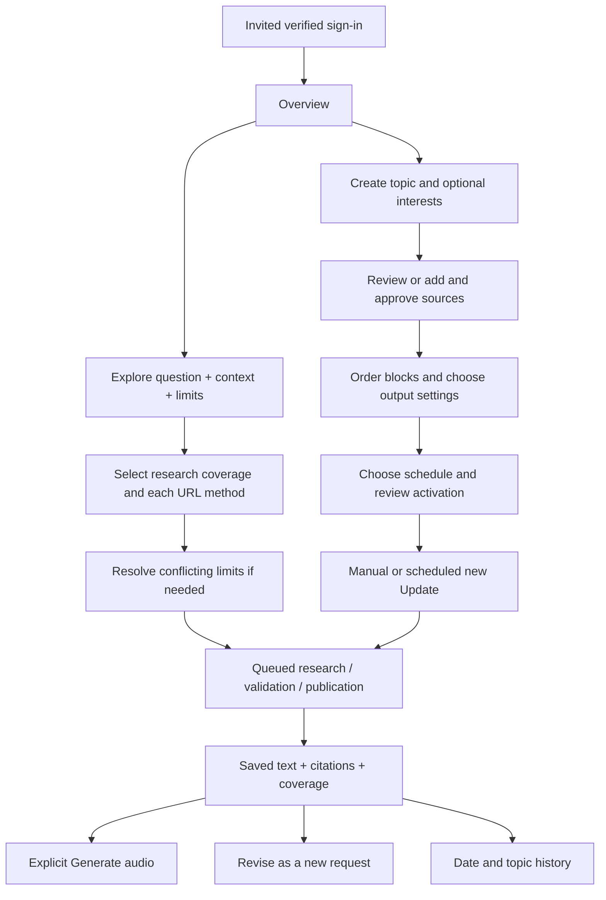

# Product workflows

| Flow | Steps and decision rules |
|---|---|
| Sign in | Use email/password or Google; verified identity must be admitted. New identity registration does not grant admission. First-time readers are prompted to create a topic. |
| Explore | Question → context/depth/limit → research mode → per-URL method → explicit submission (confirm a conflicting limit when needed) → saved run progress → published brief. Resolve conflicting requested limits before acceptance. |
| Recurring setup | Name/goal → optional subtopics (edit/add/select; regeneration retains selected chips) → publisher suggestions or manual URLs → check and approve → template blocks/order → daily/weekly timezone schedule → review/activate. Suggestions never auto-approve. |
| Source choice | Sources only restricts coverage to chosen sources; source+research adds wider search; search only ignores configured sources for this run. A `search` URL uses Tavily within that site even in sources-only mode. Changing a manual run does not change recurrence settings. |
| Update | Saved policy or manual override → frozen coverage window → retrieve fresh evidence → compare event history → prioritize changes → short/no-news only when evidence supports it → immutable publication. Retrieval failure must remain visible. |
| Audio | Open saved text without synthesis → explicit Generate audio → existing pending job or same-owner verified cache → otherwise speech/transcript/duration validation → private playback. Retry only when offered. Text is never silently rewritten to fit speech. |
| History/revision | Filter date/topic → open stable brief and citations → inspect original request/checks → revise a new Explore request. Topic/source/template edits affect future work. |
| Account | Inspect shared usage/reset/request history; export JSON and save audio separately. Deletion blocks admission immediately and remains pending until worker cleanup completes. |

See [screen walkthrough](../walkthrough/README.md), [user guide](../USER-GUIDE.md), and acceptance criteria in [Explore](EXPLORE-PRD.md) and [Stay Updated](STAY-UPDATED-PRD.md). The diagram describes the product flow; live-service completion gates remain in [current status](CHANGELOG.md).
