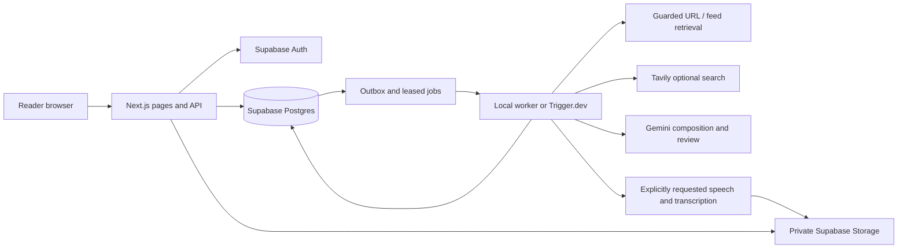

# System architecture

Afield is a Next.js web application plus an independently running job worker, backed by Supabase. Source publication to GitHub is separate from deploying the web runtime, database and worker.

The repository uses one npm workspace. `apps/web/` owns the runnable app, tests, SQL migrations and app-specific configuration. `docs/`, `.github/` and `tooling/` serve the whole project. Root npm commands forward to the app.

## Code boundaries

| Location | Responsibility |
|---|---|
| `apps/web/src/app` | Framework adapters and authenticated/rate-limited API composition |
| `apps/web/src/components/workspace.tsx` | Reader navigation/state and feature-screen composition |
| `apps/web/src/features` | Feature-owned models, API handlers, UI, services and unit tests; see the feature index |
| `apps/web/src/features/auth` | Credential/identity contracts, sign-in/callback handlers, admission and verified-session guard |
| `apps/web/src/shared` | Output-budget contracts, shared UI, browser HTTP helper and date formatting |
| `apps/web/src/infrastructure` | Supabase session/database clients, database error mapping, generic HTTP validation, provider adapters and safe public fetching |
| `apps/web/src/config`, `apps/web/src/core` | Environment switches, errors, hashes and common bounds |
| `apps/web/src/trigger`, `apps/web/scripts` | Hosted wrappers and local worker/readiness entry points |
| `apps/web/supabase/migrations` | Ordered relational schema, constraints, RLS and transactional commands |

[Product feature map](PRODUCT-ARCHITECTURE.md) · [Authentication design](AUTHENTICATION.md) · [Models and relational schema](DATA-MODELS.md).

## Request and generation lifecycle

1. Browser sends same-origin JSON. Server verifies the Supabase user, confirmed email and database admission; it derives ownership from the session.
2. Prepare validates the request, source mode and conflicting output limits. Acceptance stores an immutable input snapshot and idempotency key/hash in a run and durable outbox.
3. Worker claims a database lease. Retrieval produces source checks and evidence; safe fetch pins public DNS, blocks private/reserved destinations, rechecks redirects and bounds content/time.
4. Composition uses retrieved evidence and structured outputs. Citation identifiers, bounds and content are checked and reviewed before atomic publication. A failure remains a failed/partial state, rather than fabricated no-news content.
5. Published text remains stable. Audio starts only from an explicit action, using canonical text. The worker verifies transcript/duration and selects a matching private asset; same-owner matching text/profile can reuse verified media.
6. Schedules enqueue new runs using saved topic policy. Cleanup handles retention and requested deletion. Saved text stays readable when workers stop; new work waits.

## Security and operational boundaries

Browser roles use RLS and ownership predicates; privileged run/publication/cache functions require server credentials. `private.allowed_emails` is the sole admission list. Run drafts, lease tokens and private object paths are not reader-editable. Private audio receives short-lived signed access after ownership/hash checks. User data is not publicly cached; mutations enforce origin; React escapes text and a nonce CSP limits scripts.

Source content and model output are untrusted data. No provider secret is sent to source sites or exposed in `NEXT_PUBLIC_` variables. Live calls require explicit runtime switches and operator free-plan verification; those switches do not detect billing status. Shared usage reservations bound calls; provider dashboards remain authoritative for external usage. Text-model choices are explicit with no paid fallback.

Database SQL is authoritative for transactions/leases and privacy constraints. See [models](DATA-MODELS.md), [API](API.md), [deployment](DEPLOYMENT.md) and [known gaps](../product/CHANGELOG.md). The workspace now composes feature screens, and the central API dispatcher delegates to feature handlers after shared authorization/rate checks. This remains one modular application and worker pipeline, not independently deployed microservices.
