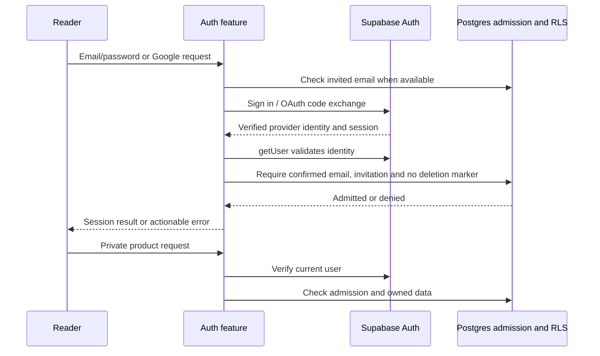
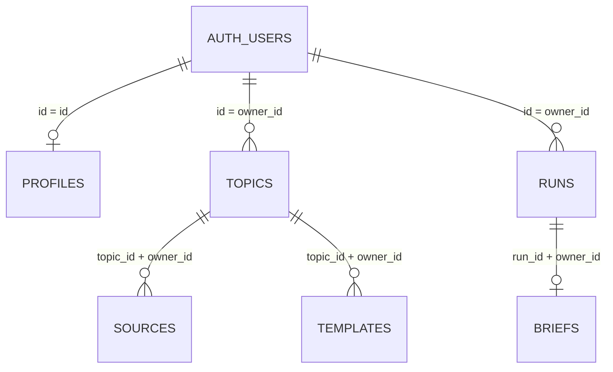

# Authentication model and access design

Authentication is a product feature in [apps/web/src/features/auth](../../apps/web/src/features/auth). The [models](../../apps/web/src/features/auth/models.ts) define application identity and credential-input contracts. Supabase Auth owns stored identities, sessions and password handling; Afield stores product data under that identity. This refactor introduces no new identity table or migration.

| Application contract | Meaning | Persistence |
|---|---|---|
| `AuthIdentity` | Public `{ id, email }` returned in the account summary | A projection of the provider user; no copied password or token |
| `VerifiedAuthUser` | Provider `User` with nonempty email and confirmation time, returned only after the guard verifies them | Server-only result of `getUser` plus database admission |
| `emailAuthInputSchema` | Normalized valid email and optional bounded password for login/signup/reset routing | Request data; password is passed to the auth provider, not saved in application tables |
| `passwordUpdateSchema` | Required password with the existing 12–128 character bounds | Transient authenticated update request |

`VerifiedAuthUser` is a TypeScript assertion after runtime checks, not a client-granted role. The server guard verifies the provider response and queries database admission for each private operation; it does not trust reader-submitted owner IDs or user-editable metadata.

## Sign-in and authorization flow

Email registration/recovery checks admission before provider calls. OAuth cannot know the authenticated email until exchange; the callback checks it then and signs out denied identities. The session client uses HTTP-only, same-site cookies and secure cookies on HTTPS. Modifying HTTP requests also enforce the configured origin. Database RLS remains an independent owner/admission boundary.

## Identity and product-data relationships

`auth.users` is provider-managed. `public.profiles.id` is a foreign key to its UUID and holds timezone/deletion state when a profile row exists; it is not a duplicate credentials table, and the current migrations do not create a profile row at every signup. `private.allowed_emails` has an email primary key and no foreign key to `auth.users`: the admission function compares the authenticated user's lowercase email at runtime. `private.usage` is a shared metric/period ledger, not a user-role table. Owner UUIDs, same-owner composite references and RLS protect topic/run/brief data.

Supabase manages sessions separately; Afield uses its SDK rather than migrating provider session tables. See the official [user-data model](https://supabase.com/docs/guides/auth/managing-user-data) and [session model](https://supabase.com/docs/guides/auth/sessions). Application-specific SQL remains authoritative in [the five migrations](../../apps/web/supabase/migrations).

## Files and verification

[Handlers](../../apps/web/src/features/auth/handlers.ts) orchestrate auth actions; [session guard](../../apps/web/src/features/auth/session.ts) enforces access; [admission lookup](../../apps/web/src/features/auth/access.ts) uses the database; [cookie client](../../apps/web/src/infrastructure/supabase/session-client.ts) isolates the provider integration. The Next.js route is a thin adapter.

Colocated [auth tests](../../apps/web/src/features/auth/__tests__) cover callback cancellation/expiry, denied invitations, provider errors, invalid/unverified identities, revoked admission and admitted success. Disposable SQL tests cover ownership/privileges and deletion admission. Browser fixtures test the screen. Fresh interactive OAuth, email verification and recovery remain live acceptance gates. No remote schema or auth settings were changed by this refactor.
