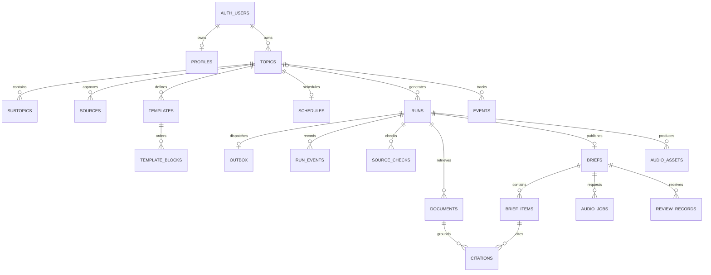

# Database schema and domain models

The five ordered files in [apps/web/supabase/migrations](../../apps/web/supabase/migrations) are the executable schema; apply all of them to a fresh project. Later migrations change initial audio, source and admission contracts. Do not infer current behavior from the initial SQL alone. This document is a map, not a second migration source.

The complete generated [column/constraint/index/RLS reference](DATABASE-SCHEMA.md) and [machine-readable schema](schema.json) are derived from a disposable database after applying every migration. Regenerate them with `npm run docs:schema`; no live database or private rows are read.

## Table dictionary

| Table | Key data / purpose |
|---|---|
| `auth.users` | Supabase-owned identity; application does not store passwords |
| `public.profiles` | Identity key, timezone, deletion marker |
| `private.allowed_emails` | Lowercase admitted addresses; sole source of admission |
| `private.usage` | Metric + period composite key; shared usage reservations |
| `public.topics` | UUID/owner, name, JSON config, draft/active/paused, confirmation and optional originating brief |
| `public.subtopics` | Owned topic, interest name, display position |
| `public.sources` | Owned topic and JSON URL/name/scope/status/rationale config |
| `public.templates`, `public.template_blocks` | Owned versioned template config and ordered block types |
| `public.schedules` | Topic primary key, owner, recurrence config, next instant and checkpoint |
| `public.runs` | UUID/owner/topic, Explore/Update intent, trigger, request key/hash, frozen JSON snapshot, status/stage/error, lease and attempts |
| `public.outbox` | One dispatch row per run, dispatch time/attempts |
| `public.run_events` | Owned run, stage/status/time and redacted error code |
| `public.source_checks` | Run/owner, attempted scope, success/empty/blocked/failed, document count/reason/time |
| `public.documents` | Run/owner, original URL/title/publisher, publication/retrieval time, content hash/text and followed/discovered origin |
| `public.briefs` | One per run; immutable text/content/citation snapshot, word count, partial flag, budget/audio status and selected audio |
| `public.brief_items`, `public.citations` | Ordered item JSON and same-owner/run document references |
| `public.events` | Topic event fingerprints/summaries used for novelty comparison |
| `public.review_records` | Brief usefulness rating (1–5) and notes |
| `public.audio_jobs` | Explicit narration request, status and worker lease |
| `public.audio_assets` | Owned run/text hash, voice profile, private object path, duration/bytes, processing/ready/failed and verification/cache metadata |

The SQL defines 21 application tables across public/private schemas. Auth and Storage maintain additional platform tables. Owner/topic/run composite foreign keys enforce matching references; request identity is unique by owner/intent/request key, and publication is unique per run. Date is not a brief key; multiple briefs may share a local date. Timestamps are UTC; named timezones determine scheduling/calendar ranges.

## Application models and their database correlation

| Model / owner | Definition | Persisted correlation |
|---|---|---|
| Authentication | [auth/models.ts](../../apps/web/src/features/auth/models.ts) | Provider User / public identity; profiles and admission are separate product-access records |
| Account summary | [account/models.ts](../../apps/web/src/features/account/models.ts) | Composes identity, usage/reset times and capability flags; not a database table |
| Output limit and depth | [shared/contracts/output.ts](../../apps/web/src/shared/contracts/output.ts) | Embedded in topic/template JSON and accepted run snapshots |
| Explore request | [explore/models.ts](../../apps/web/src/features/explore/models.ts) | Prompt, context, sources, coverage and limits in `runs.snapshot`; no extra Explore table |
| Topic and configuration | [topics/models.ts](../../apps/web/src/features/topics/models.ts) | `topics.config` plus owned source/template/subtopic/schedule rows |
| Evidence and source checks | [research/models.ts](../../apps/web/src/features/research/models.ts) | `documents` and `source_checks`, identified by owned run |
| Run | [generation/models.ts](../../apps/web/src/features/generation/models.ts) | `runs`; related outbox/events/leases are internal execution state |
| Content, Brief, BriefRow | [briefs/models.ts](../../apps/web/src/features/briefs/models.ts) | Immutable `briefs` snapshot, normalized `brief_items`/`citations`; BriefRow is a listing projection |
| Audio execution | [audio/service.ts](../../apps/web/src/features/audio/service.ts) | Explicit `audio_jobs`, verified `audio_assets`, selected audio reference on the brief |

Zod schemas validate incoming/configuration/model output; TypeScript types describe values in code; SQL defines durable records and enforces relational integrity. They are connected contracts rather than three separate sources of product truth. The app uses Supabase queries and transactional SQL RPCs, not an unimplemented ORM schema. Word budgets remain 400/800/1400; listening budgets are 60–900 seconds in minute increments. Topic contracts bound interests, sources, templates and block order.

### How relationships enforce ownership

- `auth.users.id → profiles.id` is an optional one-to-one profile relation; `auth.users.id → topics.owner_id` and `runs.owner_id` establish the owner identity.
- Sources, templates, schedules and subtopics reference `(topic_id, owner_id)`, so they cannot attach to another owner's topic. Template blocks reference `(template_id, owner_id, topic_id)`.
- An Explore run has no topic and is manual; an Update run references a topic. A run snapshots accepted inputs so later configuration edits do not change its meaning.
- `briefs.run_id` is unique: one published result per run. A topic can have many runs/briefs and multiple results on the same date.
- Brief items reference a brief/run/owner; citation rows join those items to evidence documents under the same run/owner. The brief also keeps a rendered citation snapshot for stable reading.
- Selected audio is checked by its asset ID, owner, run and text hash. Reuse can create per-run asset metadata referencing a previously verified same-owner media object; the later migration allows shared physical storage paths while preserving selected-asset checks.
- The admission list is an email-based runtime check, not a foreign key or editable client role. RLS and server guards are additional access rules, not substitutes for the relationships above.

### Configuration versus historical snapshots

Editable topic/source/template JSON is validated in the application. Normalized child records provide relationships and ordered subtopics/blocks. Accepting a run captures its configuration and coverage window; publication saves text, items and citations together. Changing a source later changes future retrieval while the saved brief retains its own evidence. This deliberate duplication preserves history and auditability rather than treating current configuration as historical truth.

Source modes: `sources_only`, `web_only`, `sources_and_web`. Per-URL scopes: `page` (exact page), `feed` (RSS/Atom), `site` (bounded links), `search` (domain search). Source approval: recommended/approved/disabled/removed. Wider web discovery and selected-site search are distinct permissions; sources-only may search an explicitly chosen site.

Audio can remain `not_requested`; later states reflect queueing/processing/readiness/failure. Listening budgets remain unverified before measured requested narration. Cache reuse requires the same owner and matching canonical-script/profile metadata; no cross-user cache sharing.

Published text/citation snapshots survive source edits. Raw unused evidence expires after 30 days, redacted run events after 14 days and unselected media after 24 hours; selected/cited data remain until account deletion. Cleanup requires a worker. Exported JSON is not a full media backup. RLS/read grants and privileged function permissions are defined by the migrations and exercised by disposable database tests; no private production rows are checked into Git.
