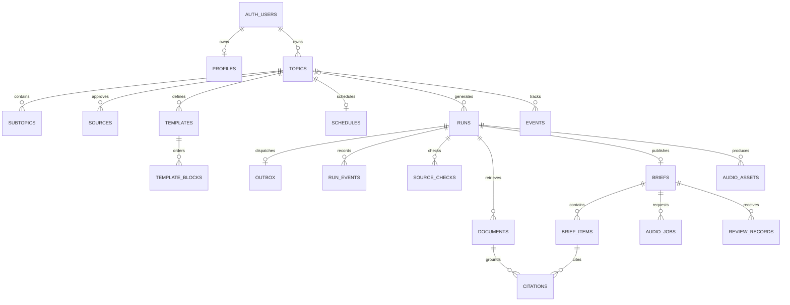

# Database schema and domain models

The five ordered files in [supabase/migrations](../../supabase/migrations) are the executable schema; apply all of them to a fresh project. Later migrations change initial audio, source and admission contracts. Do not infer current behavior from the initial SQL alone. This document is a map, not a second migration source.

## Table dictionary

| Table | Key data / purpose |
|---|---|
| `auth.users` | Supabase-owned identity; application does not store passwords |
| `public.profiles` | Identity key, timezone, deletion marker |
| `private.allowed_emails` | Lowercase admitted addresses; sole source of admission |
| `private.usage` | Metric + period composite key; shared usage reservations |
| `public.topics` | UUID/owner, name, JSON config, draft/active/paused, confirmation and optional originating brief |
| `public.subtopics` | Owned topic, interest name, display position |
| `public.sources` | Owned topic and JSON URL/name/scope/status/rationale config |
| `public.templates`, `public.template_blocks` | Owned versioned template config and ordered block types |
| `public.schedules` | Topic primary key, owner, recurrence config, next instant and checkpoint |
| `public.runs` | UUID/owner/topic, Explore/Update intent, trigger, request key/hash, frozen JSON snapshot, status/stage/error, lease and attempts |
| `public.outbox` | One dispatch row per run, dispatch time/attempts |
| `public.run_events` | Owned run, stage/status/time and redacted error code |
| `public.source_checks` | Run/owner, attempted scope, success/empty/blocked/failed, document count/reason/time |
| `public.documents` | Run/owner, original URL/title/publisher, publication/retrieval time, content hash/text and followed/discovered origin |
| `public.briefs` | One per run; immutable text/content/citation snapshot, word count, partial flag, budget/audio status and selected audio |
| `public.brief_items`, `public.citations` | Ordered item JSON and same-owner/run document references |
| `public.events` | Topic event fingerprints/summaries used for novelty comparison |
| `public.review_records` | Brief usefulness rating (1–5) and notes |
| `public.audio_jobs` | Explicit narration request, status and worker lease |
| `public.audio_assets` | Owned run/text hash, voice profile, private object path, duration/bytes, processing/ready/failed and verification/cache metadata |

The SQL defines 21 application tables across public/private schemas. Auth and Storage maintain additional platform tables. Owner/topic/run composite foreign keys enforce matching references; request identity is unique by owner/intent/request key, and publication is unique per run. Date is not a brief key; multiple briefs may share a local date. Timestamps are UTC; named timezones determine scheduling/calendar ranges.

## Application contracts

| Module | Models and bounds |
|---|---|
| [inputs](../../src/domain/inputs.ts) | `OutputLimit`, `SourceMode`, Explore schema and direct-source schema. Word budgets: 400/800/1400; listening budgets: 60–900 seconds in 60-second increments; up to five direct URLs |
| [topics](../../src/domain/topics.ts) | `TopicConfig`, schedule, source, template and block schemas. Up to 20 subtopics, 10 sources (five approved), 10 templates and eight distinct blocks; daily/weekly schedule and valid named timezone |
| [research](../../src/domain/research.ts) | `Evidence` and `SourceCheck`; text plus traceable metadata and retrieval outcome |
| [runs](../../src/domain/runs.ts) | `Run`, input/config snapshot, stage/status/events/attempts and internal lease/draft fields |
| [briefs](../../src/domain/briefs.ts) | Structured content and `Brief`; canonical text/hash, citations, source checks, partial/budget/audio state |
| [contract exports](../../src/domain/contracts.ts) | Public re-export surface; definitions live in their owning files |

Source modes: `sources_only`, `web_only`, `sources_and_web`. Per-URL scopes: `page` (exact page), `feed` (RSS/Atom), `site` (bounded links), `search` (domain search). Source approval: recommended/approved/disabled/removed. Wider web discovery and selected-site search are distinct permissions; sources-only may search an explicitly chosen site.

Audio can remain `not_requested`; later states reflect queueing/processing/readiness/failure. Listening budgets remain unverified before measured requested narration. Cache reuse requires the same owner and matching canonical-script/profile metadata; no cross-user cache sharing.

Published text/citation snapshots survive source edits. Raw unused evidence expires after 30 days, redacted run events after 14 days and unselected media after 24 hours; selected/cited data remain until account deletion. Cleanup requires a worker. Exported JSON is not a full media backup. RLS/read grants and privileged function permissions are defined by the migrations and exercised by disposable database tests; no private production rows are checked into Git.
