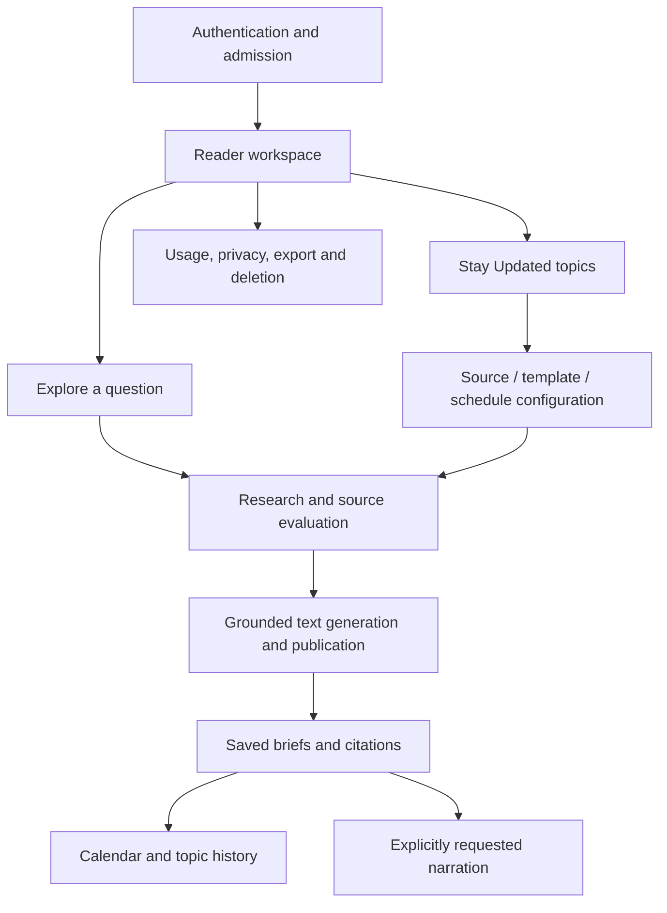

# Product architecture and feature ownership

Afield has two reader journeys—Explore a question and Stay Updated on a topic—sharing identity, retrieval, saved briefs, optional narration and history. One deployable web application can contain many independently maintained features; each feature does not need a separate application, database or long-lived Git branch.

| Feature folder | Owns | Main models / persisted records |
|---|---|---|
| `auth` | Authentication handlers, guard, admission, sign-in UI and tests | `AuthIdentity`, `VerifiedAuthUser`, credential schemas; provider `auth.users`, admission list |
| `account` | Account/usage projection, privacy UI, export and deletion API | `AccountSummary`; profiles, shared usage ledger and owned-data export |
| `explore` | Question inputs, coverage/budget preparation, request acceptance and compose UI | Explore schema; saved as a run snapshot rather than a separate Explore table |
| `topics` | Topic editor, optional subtopics, source approvals, templates and setup | `Topic`, `TopicConfig`; topics, subtopics, sources, templates, template_blocks, schedules |
| `research` | Page/feed/link/site search, publisher recommendations, source UI and evidence | `Evidence`, `SourceCheck`, source-mode/direct-source schemas; documents and source_checks |
| `generation` | Leased execution, evidence-based composition/review/publication and run progress | `Run`; runs, outbox, run_events, events and publication transaction |
| `briefs` | Reading detail/cards, persisted-brief queries, feedback and audio-request command | `Content`, `Brief`, `BriefRow`; briefs, brief_items, citations, review_records |
| `history` | Date/topic/calendar navigation | Reuses BriefRow and brief queries; no duplicate History table |
| `audio` | Requested synthesis, transcript/duration validation, attachment and cache reuse | audio_jobs/audio_assets and the brief's selected asset; no new identity or brief copy |
| `scheduling` | Recurrence math, durable dispatch and cleanup | schedules, outbox and leased run/audio jobs |

Feature-owned UI is under `ui/`, HTTP behavior under `api/` where applicable, models beside that behavior, and unit tests in `__tests__/`. Features need only the files they actually use; empty scaffold folders and one-file-per-trivial-function rules add no value. Cross-feature orchestration is explicit: scheduling dispatches generation/audio work; topic setup uses research controls; history reads saved briefs.

Framework pages/routes and the workspace shell compose features. Shared output budgets, presentation controls and the browser HTTP helper live in `shared/`. Infrastructure contains Supabase cookie/database clients, provider adapters, guarded fetching and generic HTTP validation. SQL migrations remain one ordered history; browser/database integration tests remain together because they exercise multiple features.

Use the [feature index](../../apps/web/src/features/README.md) to find code, [system design](ARCHITECTURE.md) for runtime components, [authentication design](AUTHENTICATION.md) for identity/access, and [model/schema map](DATA-MODELS.md) for persistence. [Development workflow](DEVELOPMENT-WORKFLOW.md) explains feature branches and pull requests.
